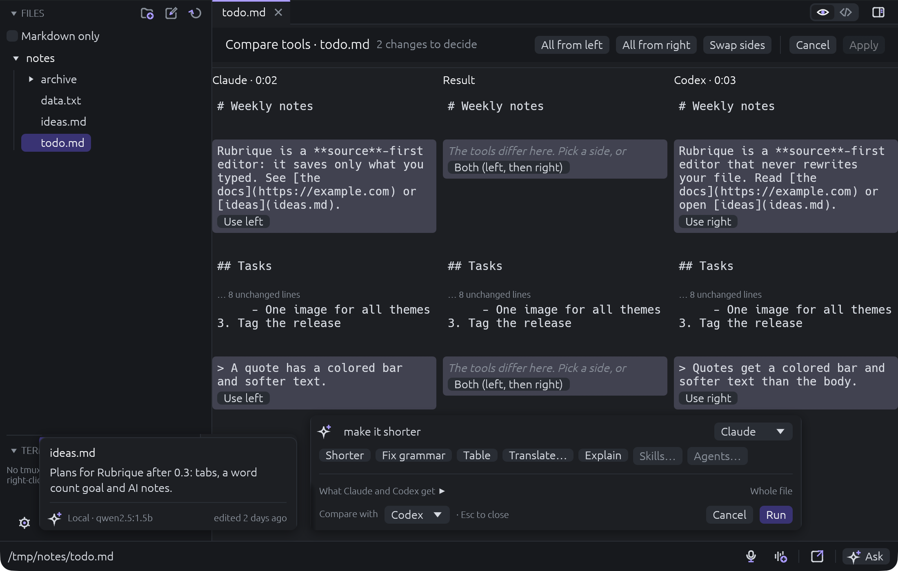
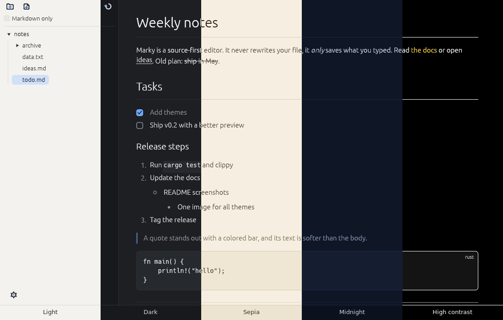

#  rubrique

An agentic Markdown editor for macOS and Linux.

rubrique puts the agents you already have to work on your notes: Claude Code,
Codex, Grok or a local model. Ask one agent, or ask two and compare their
answers. Agents run in your notes folder, read-only, and every change waits
in a merge screen until you accept it. There are no API keys, no account and
no cloud of rubrique's own. It is a small native app written in Rust, and it
saves exactly what you typed.



## Install

Download the latest version from [Releases](https://github.com/witseko/rubrique/releases).

| System | How |
| --- | --- |
| macOS (Apple Silicon and Intel) | Open the `.dmg`, drag rubrique to Applications |
| Debian, Ubuntu | `sudo apt install ./rubrique_X.Y.Z-1_amd64.deb` |
| Other Linux | Unpack the `.tar.gz`, run `./install.sh` (to `~/.local`) |

From 0.5.0 the macOS app is signed and notarized. For 0.4.x and older,
macOS blocks it on first open: run
`xattr -dr com.apple.quarantine /Applications/rubrique.app` once.

## Agents

- **Ask** (`Cmd/Ctrl+K`): type a request or pick Shorter, Fix grammar, Table,
  Translate or Explain. Works on the selection or the whole file.
- **Compare**: send one request to two agents and keep the best parts of each.
- **Review**: every change an agent makes opens in the merge screen first.
  Nothing is applied until you accept it.
- **See what the agent gets**: the Ask bar shows the request, the text,
  rubrique's instructions, the skill, the exact command and the folder
  before anything runs.
- **Skills**: reusable instructions as `SKILL.md` folders, the same format as
  Claude Code skills. Your `~/.claude/skills` work here too.
- **Named agents**: helpers with their own personality, skills, tool and
  model. Type `@ai-editor` in Ask to use one. Set them up in Settings →
  Agents as `AGENT.md` folders; Claude Code agents work too.
- **Notes**: leave a note on a passage and let the agent resolve it, one at a
  time or all at once.
- **Hover summaries**: rest the pointer on a file for a two-sentence summary
  from a local model.

Agents run only when you ask, except local summaries, which you can turn off.
The built-in commands are read-only: Claude Code in plan mode, Codex in its
read-only sandbox. Cloud agents run only in folders you allowed.

## Writing

- **Voice memos** (`Cmd/Ctrl+Shift+R`): record into the note, then
  **Transcribe** it with whisper.cpp on your computer.
- **Drop images and audio** on the page: they are copied next to the note
  and linked where the cursor is.
- **Edit in the preview**: click a block to edit just that block.
- **Scratch files** (`Cmd/Ctrl+N`): an empty note for later. A local model
  can suggest a name once you save it.
- **Format** (`Cmd/Ctrl+Shift+F`): pretty-print JSON, SQL or XML.

## Files

- **Explorer**: several folders at once. **Markdown only** hides other files.
- **Tabs**: each tab keeps its unsaved changes, cursor and undo history.
- **Images and videos** open in their own view.
- **Safe saves**: rubrique never reformats your file. If another program
  changes it, you get a side-by-side merge. Quitting keeps unsaved edits
  for the next start without touching the file.
- **Open in browser** (`Cmd/Ctrl+Shift+B`): the note as a web page.
- **Find** (`Cmd/Ctrl+F`): matches in the open file are tinted; Enter and
  Shift+Enter step through them. **All files** searches every text file in
  the explorer's folders, by name and by content; a click opens the match.



Five built-in themes: Light, Dark, Sepia, Midnight, High contrast. Or follow
the system, or add your own. Settings → Accessibility sets the text size, the
editor font size, line numbers, reduced motion and a stronger focus outline.

## Shortcuts

`Cmd` on macOS, `Ctrl` on Linux.

| Shortcut | Action |
| --- | --- |
| Cmd+K | Ask an agent |
| Cmd+F | Find in this file, or in all files |
| Cmd+Shift+R | Record a voice memo, or stop |
| Cmd+Shift+M | Add a note to the selection |
| Cmd+E | Switch between preview and source |
| Cmd+N | New scratch file |

<details>
<summary>All shortcuts</summary>

| Shortcut | Action |
| --- | --- |
| Cmd+S | Save |
| Cmd+W | Close tab |
| Ctrl+Tab / Ctrl+Shift+Tab | Next / previous tab |
| Cmd+, | Settings |
| Cmd++ / Cmd+- / Cmd+0 | Larger / smaller / default text size |
| Cmd+Shift+B | Open in browser |
| Cmd+Shift+F | Format JSON, SQL or XML |
| Cmd+Shift+C | Copy the open file's path |
| Cmd+G / Cmd+Shift+G | Next / previous match |
| Alt+Up / Alt+Down | Move lines |
| Cmd+D | Duplicate lines |
| Cmd+Shift+D | Insert today's date |

</details>

## Set up the agents

rubrique finds these programs on your `PATH`. Install the ones you want:

| Tool | Program | Used for |
| --- | --- | --- |
| Claude Code | `claude` | Ask, Compare, Notes |
| Codex | `codex` | Ask, Compare, Notes |
| Grok | `grok` | Ask, Compare, Notes |
| Ollama | `ollama` | Local summaries, file names |
| whisper.cpp | `whisper-cli` | Transcribing memos |

Settings → AI shows which ones were found and lets you change each command.
When one is missing, rubrique offers its install command and shows it first.

whisper.cpp also needs its model:

```sh
curl -L --create-dirs -o ~/.local/share/whisper/ggml-small.bin \
  https://huggingface.co/ggerganov/whisper.cpp/resolve/main/ggml-small.bin
```

## Themes

1. Create a `.theme` file in `~/.config/rubrique/themes/`
   (macOS: `~/Library/Application Support/rubrique/themes/`).
2. Set only the colors you want to change:
   ```
   name=Ocean
   base=dark
   accent=#00aaff
   ```
3. Press **Reload themes** in Settings.

The built-in themes in [`themes/`](themes/) list every key.

## Build

Needs Rust 1.95 or newer. On Linux, also the X11, Wayland, OpenGL and ALSA
development libraries (`libasound2-dev` on Debian and Ubuntu).

```sh
cargo run --release -- ~/notes
```

Before a pull request:

```sh
cargo test
cargo clippy --all-targets -- -D warnings
cargo fmt --check
cargo deny check
```

## Release

rubrique follows [Semantic Versioning](https://semver.org). See
[`CHANGELOG.md`](CHANGELOG.md).

1. Move the notes under **Unreleased** in `CHANGELOG.md` to a new version.
2. Set the same `version` in `Cargo.toml`.
3. Push to `main`.

The Release workflow builds the packages, tags the version and publishes a
GitHub release with the changelog notes. The wording used to describe
rubrique lives in [`docs/positioning.md`](docs/positioning.md).
